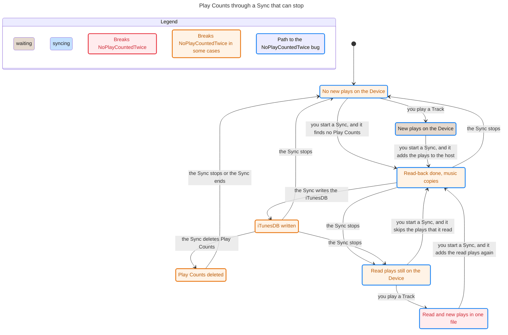

## State chart

This chart shows the behavior that this PR verifies: the Play Counts file of one Device through a Sync that can stop.
TLC drew it from a scratch copy of `ReadBack.tla` with two plays and two Syncs (87 states).
In that copy, the start of a Sync and its Read-back are one step, because a stop between them changes nothing.

The bug that the chart marks:

- `NoPlayCountedTwice` breaks: "Each play on the Device counts one time in the host Play Data."
  Path: you play a Track, you start a Sync and it adds the plays to the host, the Sync stops, you play a Track.
  The next Sync then adds the read plays again.

After the double count, a later state can keep the wrong count, so the chart marks those states "in some cases".
The chart does not draw a step that stays in one chart state.
An example is a second play when new plays are already on the Device.
The view hides the end step of the model, which changes nothing.

Covered digest: `173da93988e0dc5b0b93deb19be27960357489075295abf82834dc5af3917253`
